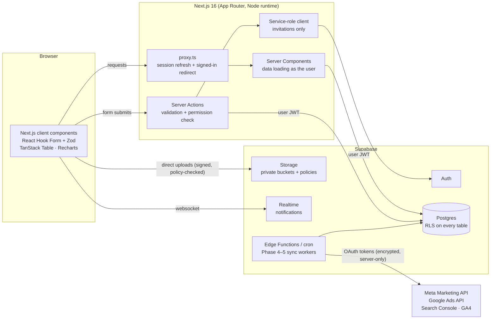
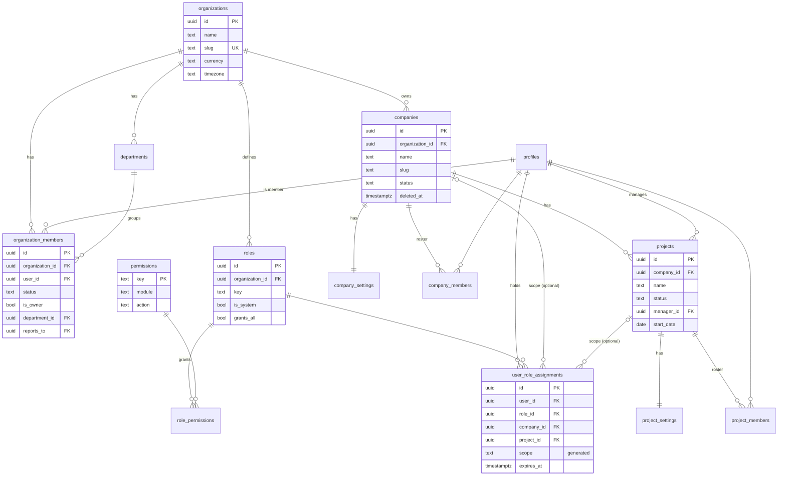
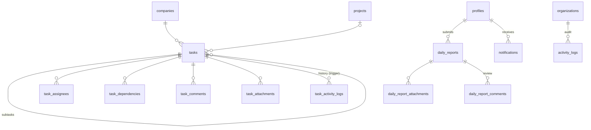
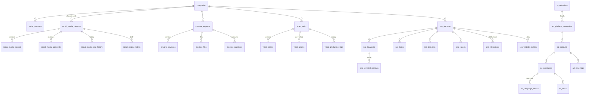

# Architecture

Multi-company Digital Marketing Management & Monitoring Platform.
This document covers the system architecture, data model (with ER diagrams),
permission design, folder structure, integration strategy and the phased
roadmap. It describes what is built (Phase 1) and the foundations already laid
for Phases 2–6.

---

## 1. System overview



**Principles**

1. **The database is the security boundary.** Every table has Row Level
   Security. Server actions check permissions too (for good error messages),
   and the UI hides what you cannot do, but neither is relied upon.
2. **Act as the user.** Server Components and Server Actions use the signed-in
   user's Supabase session, so RLS applies to every query. The service-role
   key is used in exactly one place: sending invitations via the Auth admin API.
3. **One permission model, one place.** All checks go through SQL helper
   functions (`private.has_*_permission`, `private.can`, …). The TypeScript
   mirror in `src/lib/permissions.ts` is only used to decide what to *show*.
4. **No external API calls on page load.** Ads/SEO data is synchronised in the
   background and stored as daily facts; dashboards read Postgres only.
5. **Dynamic rendering.** Every screen is per-user and permission-filtered, so
   pages render per request (`cacheComponents` is off). Caching can be added
   per route later without structural changes.

---

## 2. Tenancy model

```
Organization ──┬── Departments
               ├── Roles ── Role permissions ──> Permission catalog
               ├── Members (status, department, reports_to)
               └── Companies ── Projects
                       │            │
                       └── every activity row carries company_id (+ project_id)
```

* One deployment serves one organization in practice, but the schema is
  multi-organization ready.
* **Every activity row has `company_id NOT NULL`**, and `project_id` when it is
  project work. A composite foreign key `(project_id, company_id) →
  projects(id, company_id)` makes it impossible to attach a project to the wrong
  company.
* A project can never move to another company (trigger), so historical data
  stays consistent.

---

## 3. Permission design

### 3.1 Permission catalog

Permissions are `module.action` keys stored in `public.permissions`
(seeded by migration, never created at runtime):

| Module | Keys |
|---|---|
| Administration | `settings.manage`, `users.view`, `users.manage`, `roles.manage`, `departments.manage`, `integrations.manage`, `activity.view` |
| Companies | `companies.view`, `companies.create`, `companies.edit`, `companies.delete` |
| Projects | `projects.view`, `projects.create`, `projects.edit`, `projects.delete` |
| Dashboards & reports | `dashboard.executive`, `team.view_performance`, `reports.view`, `reports.export` |
| Tasks | `tasks.view` (own/assigned), `tasks.view_all`, `tasks.create`, `tasks.assign`, `tasks.edit`, `tasks.delete`, `tasks.approve` |
| Daily reports | `daily_reports.submit`, `daily_reports.view_all`, `daily_reports.review` |
| Social media | `social.view`, `social.manage`, `social.review`, `social.approve`, `social.publish` |
| Advertising | `ads.view`, `ads.manage`, `ads.manual_entry` |
| Creatives | `creatives.view`, `creatives.manage`, `creatives.upload`, `creatives.review`, `creatives.approve` |
| Video | `video.view`, `video.manage`, `video.upload`, `video.approve` |
| SEO | `seo.view`, `seo.manage` |

### 3.2 Roles

Roles belong to an organization. Eight **default roles** are created for every
organization (and can be renamed/adjusted, not deleted): Super Admin,
Management, Digital Marketing Manager, Assistant Team Leader, Ads Team,
Creatives & Social Media Team, In-House Content Creator, SEO Team.
Admins create any number of **custom roles** with any permission set
(Settings → Roles & permissions → permission matrix).

`roles.grants_all = true` marks a full-access role (Super Admin). Only a Super
Admin can create, modify or grant such a role (database trigger), which stops a
user who merely has `users.manage` from escalating to full access.

### 3.3 Scoped role assignments — the core idea

`user_role_assignments(user, role, company_id?, project_id?)` is the single
source of truth for *who can do what, where*:

| Scope | company_id | project_id | Covers |
|---|---|---|---|
| organization | NULL | NULL | every company and project |
| company | set | NULL | that company and **all** its projects |
| project | set | set | that project only |

A person can hold different roles in different places, e.g.
*Ads Team for Company A* + *Social Media Manager for Company B* +
*SEO Viewer (custom) for Project C1*.

**Resolution rules** (implemented once, in `private.my_grants()` and helpers):

* Only **active** organization members get any grant (suspend = instant lockout,
  roles are kept for restoring).
* The organization **owner** implicitly holds everything (cannot be removed,
  suspended or demoted — lock-out protection).
* Expired assignments (`expires_at`) are ignored.
* Company-level data (rows without `project_id`) is only covered by
  organization- or company-scope grants; a project-only member never sees
  company-level work.
* A project-only member can see the parent company's basic profile (name,
  logo) so the UI makes sense, nothing else.

`company_members` / `project_members` are rosters kept in sync with
assignments by triggers (add a company role → appear on the company roster;
remove someone from the roster → their roles there are revoked).

### 3.4 Where checks happen

| Layer | Mechanism |
|---|---|
| Database (authoritative) | RLS policies using `private.permitted_company_ids(perm)` / `permitted_project_ids(perm)` for reads (evaluated once per query) and `private.can(perm, company, project)` for writes; triggers for field-level and workflow rules (approvals, soft delete, immutable approved versions, API-sourced metrics read-only); column-level GRANTs for protected columns |
| Storage | Policies on `storage.objects`: a file is readable only if the record it belongs to (first path segment) is readable by the user; uploads need write permission on that record |
| Server actions | Zod validation, `ctx.can(...)` check, then the query as the user; "0 rows updated" is reported as no access |
| UI | `useShell().can(...)` hides buttons and menu items |

### 3.5 Helper functions

| Function | Purpose |
|---|---|
| `private.my_grants()` | caller's effective grants `(org, company, project, permission or '*')` |
| `private.has_org_permission(org, perm)` | organization-scope check |
| `private.has_company_permission(company, perm)` | org- or company-scope |
| `private.has_project_permission(project, perm)` | org-, company- or project-scope |
| `private.can(perm, company, project)` | picks the right check for a row |
| `private.permitted_company_ids(perm)` / `permitted_project_ids(perm)` | set-returning variants for fast RLS reads |
| `private.accessible_company_ids()` / `accessible_project_ids()` | visibility regardless of module |
| `public.has_permission(...)`, `public.get_my_grants()` | RPC for the app (caller's own permissions only) |
| `public.global_search(q)` | SECURITY INVOKER search across all entities, RLS-filtered |
| `public.create_organization(name)` | first-run bootstrap (refused once an org exists) |

All are `SECURITY DEFINER` with an empty `search_path` (except the invoker
search) and only ever answer questions about the calling user.

---

## 4. Data model

53 specification tables plus a few supporting ones (`task_dependencies`,
`daily_report_comments`, `private.integration_credentials`). Conventions:
UUID keys, `created_at`/`updated_at` (trigger), `created_by` (auto-stamped),
`deleted_at` soft delete on business records, `TEXT + CHECK` status columns
(evolvable without enum migrations).

### 4.1 Core tenancy & access (Phase 1)



### 4.2 Work management (Phase 2 tables, created now)



### 4.3 Marketing modules (Phases 3–5 tables, created now)



Notable design decisions already enforced in the schema:

* **Social calendar** keeps `workflow_status` (Idea → … → Published) and
  `publishing_status` (planned / scheduled / published / failed) separate —
  a calendar entry never implies it was published. Scheduling past the approval
  gate requires `social.approve`; marking published requires `social.publish`.
* **Creatives / video**: approved revisions and assets are immutable (triggers
  + storage policy), new work always creates a new version.
* **Ads metrics** are a daily fact table keyed by
  campaign × date × level (campaign/ad set/ad/keyword) × breakdown
  (device/location/…) × source. People can only write `source = 'manual'`;
  API rows are written by the sync service and are read-only.
  `ad_campaign_daily_stats` derives CTR/CPC/CPM/CPL/ROAS correctly from sums.
* **SEO** ranking history updates the keyword's current/previous/best rank via
  trigger; metrics carry `source` (`manual` / `gsc` / `ga4` / `pagespeed`).
* **Credentials** live in `private.integration_credentials` — a schema not
  exposed by the API and with no grants to signed-in users. Tokens are stored
  encrypted by the server (AES-256-GCM, `INTEGRATION_ENCRYPTION_KEY`).

### 4.4 Storage buckets

| Bucket | Public | Path | Access rule |
|---|---|---|---|
| `branding` | yes (logos/avatars only) | `{org}/{companies\|projects\|avatars\|organization}/{id}/…` | write needs edit permission on that entity (or own avatar) |
| `task-files` | no | `{task_id}/…` | can see the task |
| `daily-report-files` | no | `{report_id}/…` | can see the report; author uploads |
| `social-media` | no | `{calendar_id}/…` | `social.manage` to upload |
| `creative-files` | no | `{creative_request_id}/…` | designer / `creatives.upload`; approved files undeletable |
| `video-assets` | no (10 GB limit) | `{video_task_id}/…` | crew / `video.upload`; resumable uploads straight from the browser |
| `seo-reports` | no | `{website_id}/…` | `seo.manage` |

Large videos are uploaded directly from the browser to Storage with resumable
(TUS) uploads, so files never pass through the Next.js server's memory.

---

## 5. Integration architecture (Phases 4–5)

```
src/lib/integrations/            (Phase 4)
  types.ts                       AdPlatformAdapter interface
  meta/                          OAuth, account list, campaign + insights sync
  google-ads/                    OAuth, customer/MCC accounts, GAQL sync
  crypto.ts                      AES-256-GCM token encryption
supabase/functions/              (Phase 4)
  sync-ad-metrics/               scheduled (pg_cron) + manual trigger
  sync-seo-metrics/              Search Console + GA4
```

* OAuth callbacks run server-side; tokens go straight into
  `private.integration_credentials` (encrypted). The browser never sees them.
* Scheduled sync (pg_cron → Edge Function) pulls the last N days per account,
  upserts `ad_campaign_metrics` with `source='api'`, records `ad_sync_logs`,
  retries with backoff on rate limits (`status='rate_limited'`,
  `next_retry_at`), raises `ad_alerts` (`sync_failure`, CPL spikes, budget…).
* Until an integration is connected and a real sync has succeeded, its status is
  `awaiting_configuration` and the UI says so — no fabricated data.
* New ad platforms = a new adapter + new values in the `platform` CHECK lists.

---

## 6. Folder structure

```
.
├── docs/ARCHITECTURE.md            this document
├── supabase/
│   ├── config.toml                 local Supabase CLI config
│   ├── migrations/                 0001 … 0012 (schema, RLS, functions, storage)
│   └── tests/                      SQL RLS test suites + local stubs
├── scripts/
│   ├── test-db.sh                  migrations + RLS tests on a throw-away Postgres
│   └── gen-types.sh                regenerate src/types/database.types.ts
├── src/
│   ├── proxy.ts                    session refresh + signed-in redirect (Next 16 "proxy")
│   ├── app/
│   │   ├── (auth)/                 login, signup, forgot-password
│   │   ├── auth/                   callback route, set-password
│   │   ├── onboarding/             first-run organization bootstrap
│   │   ├── no-access/              signed in but not (or no longer) a member
│   │   └── (app)/                  authenticated shell (sidebar + header)
│   │       ├── dashboard/
│   │       ├── companies/[companyId]/
│   │       ├── projects/[projectId]/
│   │       ├── team/[userId]/
│   │       ├── settings/{organization,roles/[roleId],departments}/
│   │       ├── notifications/
│   │       └── profile/
│   ├── components/
│   │   ├── ui/                     design-system primitives (shadcn-style, Radix)
│   │   ├── shared/                 page header, empty/error states, form field, image upload…
│   │   ├── layout/                 sidebar, header, scope switcher, search, notifications
│   │   ├── data-table/             TanStack Table v9 wrapper
│   │   └── companies/ projects/ team/ settings/ dashboard/ profile/
│   ├── lib/
│   │   ├── supabase/               browser, server, proxy and service-role clients
│   │   ├── auth/context.ts         data access layer: user, org, grants, scope
│   │   ├── permissions.ts          TS mirror of the SQL permission rules
│   │   ├── validations/            Zod schemas shared by forms and actions
│   │   ├── actions.ts              ActionResult + DB error mapping
│   │   └── utils.ts, env.ts, config.ts
│   ├── server/
│   │   ├── actions/                server actions per module
│   │   └── queries/                reusable server-side reads
│   └── types/database.types.ts     generated from the schema
└── .env.example
```

Each later module adds `app/(app)/<module>`, `components/<module>`,
`server/actions/<module>.ts` and a navigation entry in
`components/layout/nav-config.ts` — nothing else changes.

---

## 7. Roadmap

| Phase | Scope | Status |
|---|---|---|
| 1 | Foundation: auth, profiles, organization bootstrap, companies, projects, departments, roles & permission matrix, scoped assignments, team directory & invitations, RLS for **all** tables, storage policies, audit log, notifications centre, global search, responsive shell with company/project switcher | **Done** |
| 2 | Tasks (Kanban/list/calendar, subtasks, dependencies, comments, mentions, attachments, approvals), daily activity reports & review, employee & team-leader dashboards, notification triggers (assigned, due soon, overdue) | Schema + RLS done |
| 3 | Social media calendar (FullCalendar, dnd-kit), content versions & approvals, creative requests & gallery, AI video tracking, in-house video production with resumable uploads | Schema + RLS done |
| 4 | Meta & Google Ads OAuth, account mapping, scheduled sync, historical metrics, charts, alerts, manual entry | Schema + RLS done |
| 5 | SEO websites, keywords & ranking history, backlinks, SEO tasks & reports, Search Console & GA4 | Schema + RLS done |
| 6 | Executive dashboard & comparisons, productivity & department reports, PDF/Excel/CSV export, performance & security hardening, PWA | — |

---

## 8. Security checklist (Phase 1)

- [x] RLS enabled on every table in `public`; `anon` has no table access
- [x] Escalation guards: only Super Admins grant/modify full-access roles
- [x] Owner lock-out protection; suspended members lose all access instantly
- [x] Column-level grants protect `email`, `is_owner`, `organization_id`, `created_by`, …
- [x] Soft delete requires the `*.delete` permission (trigger)
- [x] Service-role key server-only (`server-only` import guard), used only for invitations
- [x] Credentials table unreachable through the API
- [x] Open-redirect protection on `next` parameters; header scope cookie validated against access
- [x] Image URLs saved on records must point at the organization's own branding folder
- [x] Security headers (frame-deny, nosniff, referrer policy, permissions policy)
- [x] Automated RLS tests (`npm run test:db`) covering cross-company isolation,
      project-only access, escalation attempts, owner protection, workflow guards,
      storage isolation and search filtering
